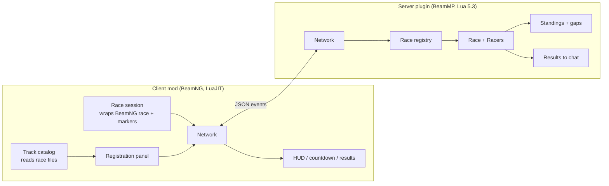
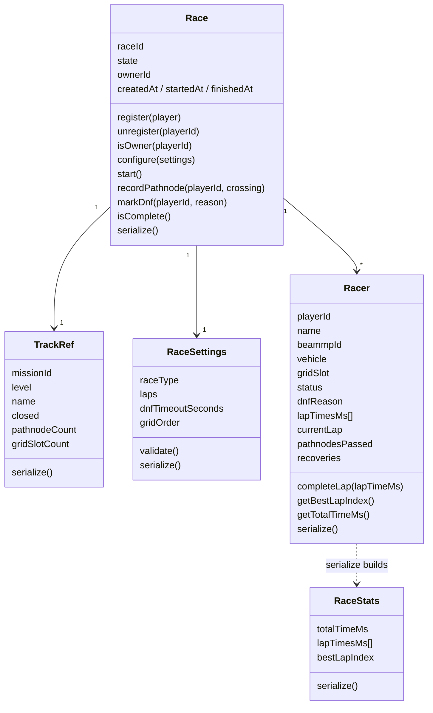
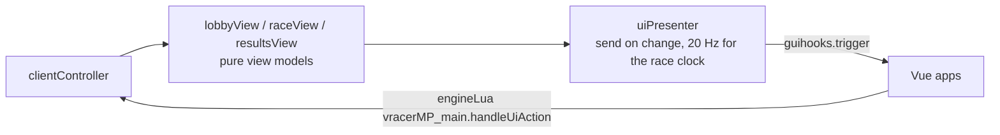

# VRacerMP — Architecture

Living document, like [requirements.md](requirements.md). Status legend is the
same: `Agreed`, `Proposed`, `Open`. Decisions go to the
[Decision log](#9-decision-log).

---

## 1. Big picture



| ID | Decision | Status |
|----|----------|--------|
| ARC-1 | **The server decides**: registration, owner, race state, positions, gaps, finish, DNF, results. | Agreed |
| ARC-2 | **The client detects and displays.** Each client tracks only *its own* car through the track and reports crossings; it shows what the server sends. | Agreed |
| ARC-3 | **Reuse BeamNG's race engine on the client** (see §2) instead of writing our own pathnode detection. | Agreed |
| ARC-4 | Every message carries a `raceId`, so several races can run at once (REG-11). | Agreed |

## 2. What we reuse from BeamNG

Found in the local install (`BeamNG.drive/lua/ge/extensions/`, game v0.40):

| BeamNG code | What it gives us | How we use it |
|-------------|------------------|---------------|
| `gameplay/race/race.lua` (class) | Loads a `race.race.json` (`setPathFile`), tracks vehicles through pathnodes in order, laps, sub-frame crossing times, recovery points. Fires `onRacePathnodeReached`, `onRaceComplete` hooks. | One instance per client, with **only the player's own vehicle**. Started at GO. Built-in Hotlapping already uses it outside missions (`core/hotlapping.lua`). |
| `scenario/race_marker.lua` + `scenario/raceMarkers/sideColumnMarker.lua` | The **two-pillar markers** from Time Trials, with modes (`next`, `default`, `final`, `hidden`) that change their colour. | `setupMarkers(pathnodes)` at race start, `setModes(...)` after each pathnode, cleared at the end. |
| `guihooks.trigger('ScenarioFlashMessage', ...)` | The animated 3-2-1 countdown used by scenarios, with sounds. | Countdown, if it shows in freeroam / BeamMP. Fallback: our own imgui overlay with size + transparency animation. |
| `controller.setFreeze(1/0)` (vehicle Lua) | Scenario-style freeze: car held in place, engine can rev. | Grid freeze (START-3, Later). |

Rules for using it:
- BeamNG code is under the **bCDDL licence**: we *call* it, we never copy it into this repo.
- All calls go through one adapter file per feature (`raceEngineAdapter.lua`,
  `markerAdapter.lua`, `countdownAdapter.lua`). When a game update changes the API,
  only that file changes (NFR-5).

> **Lap 1 note (affects TIME-2).** In BeamNG race files the car starts on the grid
> *behind* the start pathnode and is treated as already at it. Lap 1 therefore runs
> from GO, around the whole track, to the start pathnode, exactly like single-player
> Time Trials. TIME-2 said "GO to the first line crossing", which came from the old
> trigger design and would give a very short lap 1. **Agreed (A-2):** follow BeamNG's behaviour; TIME-2 updated.

## 3. Lua classes and JSON

### 3.1 Is "class → JSON" the standard?

Lua has no classes. The standard idiom (and the one BeamNG itself uses, e.g.
`race.lua`) is **a table of methods + a metatable**:

```lua
local Racer = {}
Racer.__index = Racer

function Racer.new(playerId, name)
  local self = setmetatable({}, Racer)
  self.playerId = playerId
  self.name = name
  self.lapTimesMs = {}
  return self
end

function Racer:getBestLapIndex()
  -- ...
end

return Racer
```

**But objects are not serialized directly.** `Util.JsonEncode` (server) and
`jsonEncode` (client) only understand plain tables: methods and metatables are
lost, and internal fields would leak into the file. Instead:

| ID | Rule | Status |
|----|------|--------|
| JSON-1 | Each model class has a `serialize()` method that returns a **plain table shaped exactly like the JSON schema** (names, ms integers, readable strings, 0-based `bestLap`). Parent objects call their children's `serialize()`. | Agreed |
| JSON-2 | Classes that are rebuilt from JSON have a `ClassName.deserialize(data)` constructor. | Agreed |
| JSON-3 | `serialize()` is the **only** place that knows the JSON shape. The schema in requirements §6 and these methods must match. | Agreed |
| JSON-4 | Lists are always sequences (1..n, no holes). Player IDs are fields, never keys. Empty lists are encoded as `[]` on purpose (both JSON libraries otherwise write `{}`). | Agreed |
| JSON-5 | Times inside the code are integer milliseconds. Readable strings are only produced in `serialize()` and the UI, using `timeFormat`. | Agreed |

This is the same pattern BeamNG uses (`path:onSerialize()` / `path:onDeserialized()`);
we use plainer names because the CLAUDE.md asks for descriptive names.

### 3.2 Models



Other race-rule modules:
- `standings` (plain functions) — sorts racers into positions (finished → by finish time;
  racing → by pathnode crossings, then who got there first; DNF last).
- `GapTracker` (class) — remembers the last car to reach each progress point (crossing
  number across laps); the next car to arrive gets the red gap, the car ahead the green
  gap (UI-8, UI-9). Works with lapped cars.
- `timeFormat` (shared) — `formatRaceTime(ms) → "01:24.120"` (files),
  `formatHudTime(ms) → "1:24.120"`, `formatGap(ms, isAhead) → "-0:00.214"`.

JSON keys in the results are written in alphabetical order (Lua tables have no
key order); the content matches requirements §6.

## 4. Code organisation

### 4.1 Folder layout

As built for the MVP (2026-11-08):

```
Resources/
  Server/VRacerMP/
    main.lua                          -- registers BeamMP events, forwards them (glue only)
    vracerMP/
      coordinator/raceCoordinator.lua -- player events -> race changes + messages + results
      coordinator/messageBuilder.lua  -- payloads sent to clients (pure)
      coordinator/chatCommands.lua    -- /vracer commands (testing helpers)
      races/raceRegistry.lua          -- class RaceRegistry: all races; which race a player is in
      races/race.lua                  -- class Race (state machine, pure)
      races/racer.lua                 -- class Racer (pure)
      races/raceSettings.lua          -- class RaceSettings (pure)
      races/trackRef.lua              -- class TrackRef (pure)
      races/standings.lua             -- positions (pure functions)
      races/gapTracker.lua            -- class GapTracker (pure)
      network/serverNetwork.lua       -- send / broadcast / decode (edge: MP.*)
      network/playerDirectory.lua     -- player names and BeamMP ids (edge: MP.*)
      results/resultsAnnouncer.lua    -- sends Race:serialize() to chat as JSON when the race ends
      testing/fakeRacer.lua           -- class FakeRacer, pretend opponent (A-7)
      util/serverClock.lua            -- class ServerClock (edge: MP.CreateTimer)
      util/serverLog.lua              -- log(level, tag, ...) like the client (edge: Util.Log*)
      shared/                         -- generated: copied from /shared by the build

  Client/   (zipped as VRacerMP.zip)
    scripts/vracerMP/modScript.lua    -- loads the extension
    lua/ge/extensions/vracerMP/
      main.lua                        -- extension vracerMP_main: game hooks -> controller (glue only)
      controller/clientController.lua -- server messages, session, UI wiring
      controller/uiActions.lua        -- what each UI button does
      network/clientNetwork.lua       -- send / listen (edge: BeamMP client API)
      tracks/trackCatalog.lua         -- finds race files for the current level (edge: files)
      tracks/trackInfo.lua            -- class TrackInfo (info.json + race.race.json, pure)
      tracks/gridBuilder.lua          -- grid slots, generated fallback (pure)
      tracks/startAreaWatcher.lua     -- which start area is the car in (pure)
      tracks/startAreaVisibility.lua  -- which start areas show a marker: open for registration (pure, REG-13)
      tracks/startAreaMarkers.lua     -- the only file that touches BeamNG's missionMarker (column fallback)
      lobby/lobbyStore.lua            -- class LobbyStore: latest lobby of every race (pure)
      race/raceSession.lua            -- class RaceSession: our car's race, HUD data
      race/raceEngineAdapter.lua      -- the only file that touches gameplay/race/race.lua
      race/markerAdapter.lua          -- the only file that touches race_marker / sideColumnMarker
      race/gridPlacement.lua          -- teleport to grid slot via BeamNG startPosition (freeze later)
      race/playerVehicle.lua          -- the player's vehicle: id, position, model/config
      ui/lobbyView.lua                -- lobby view model (pure)
      ui/raceView.lua                 -- race panel view model (pure)
      ui/resultsView.lua              -- results view model (pure)
      ui/sampleViews.lua              -- sample content for the layout editor (pure)
      ui/countdown.lua                -- class Countdown: 3-2-1-GO timing (pure)
      ui/uiPresenter.lua              -- class UiPresenter: send views on change (pure)
      ui/uiBridge.lua                 -- guihooks + layout editor state (edge)
      ui/layoutInstaller.lua          -- adds our apps to a layout once (edge)
      shared/                         -- generated: copied from /shared by the build
    ui/modules/apps/VRacerMP-RacePanel|Lobby|Countdown|Results/  -- app.json + app.vue (UI-T3)
    gameplay/missions/<level>/timeTrial/<mission>/  -- only for tracks that are in no map (TRK-5); empty for now

shared/                               -- written once, used by both sides
  timeFormat.lua
  protocol.lua                        -- event names
  raceStates.lua                      -- enums: race states, racer statuses, DNF reasons
  jsonEncoder.lua                     -- JSON with [] for empty lists and pretty output (JSON-4)

tests/                                -- unit tests (run on Lua 5.3 and LuaJIT)
tools/build.ps1                       -- builds export/Resources, optional -ServerPath install
tools/runTests.py                     -- runs tests/runAll.lua on both Lua versions (lupa)
tools/smokeTestServer.py              -- loads the built plugin with a mock BeamMP API, plays a race
```

Two additions to the first draft:
- **Coordinators.** Pure race classes must not send messages, so each side has one
  coordinator that combines rules with edges: `raceCoordinator` (server) and
  `clientController` (client). They receive their dependencies, so the server one is
  unit-tested with fakes.
- **`GapTracker` is a class**, not a stateless module: it has to remember who crossed
  each progress point.

### 4.2 Splitting rules

| ID | Rule | Status |
|----|------|--------|
| ORG-1 | **One responsibility per file**; file name = what it does (`gapTracker`, not `utils2`). | Agreed (CLAUDE.md) |
| ORG-2 | `main.lua` on each side is **glue only**: receives events, calls modules. No race rules inside. | Agreed |
| ORG-3 | **Race rules are pure Lua** (`race`, `racer`, `standings`, `gapTracker`, `timeFormat`): no `MP.*`, no BeamNG calls. They take data in and return data out, so they can be unit-tested outside the game. | Agreed |
| ORG-4 | **Side effects live at the edges**: network, file writing, BeamNG adapters. | Agreed |
| ORG-5 | Functions read like the CLAUDE.md example: a top-level function calls well-named smaller functions. | Agreed (CLAUDE.md) |
| ORG-6 | No globals except the BeamMP event handlers, which `MP.RegisterEvent` requires by name. Handlers are named `handle<Event>` and only delegate. | Agreed |
| ORG-7 | Logging: client `log('D', logTag, ...)`; server `Util.LogInfo/LogWarn/LogError/LogDebug`, wrapped in a small `serverLog` so code reads the same on both sides. | Agreed |

### 4.3 Shared code (avoiding repetition between client and server)

The server runs Lua 5.3 and the client LuaJIT (5.1); they ship separately. Code both
need (`timeFormat`, `protocol`, enums) lives once in `/shared` and the build script
copies it into both packages.

Shared files must use the common subset of both Lua versions:
- no `//` integer division, no `utf8`, no bit operators;
- always `math.floor` a number before `string.format("%d", ...)` (5.3 errors on
  non-integer floats);
- no game or server APIs.

## 5. Runtime flow

### 5.1 Registration

1. Each client builds its **track catalog** for the loaded level from
   `gameplay/missions/<level>/timeTrial/*/` (TrackInfo: name, start area, default laps,
   closed, pathnode count, grid slots).
2. `startAreaWatcher` notices the car entered a start area → registration panel opens.
3. Register → server creates the race if none exists for that track (first player =
   owner) and broadcasts the race's lobby state. Clients show it only to players in
   that start area.
4. Owner changes laps / DNF timeout → server validates, broadcasts.

### 5.2 Start

1. Owner presses **Start** → server assigns grid slot numbers (registration order),
   state `starting`.
2. Each client computes slot positions from its own copy of the race file
   (`gridBuilder`), teleports its car and replies *ready*.
3. When all racers are ready (or after a timeout, e.g. 10 s; missing racers are DNF),
   the server runs the countdown with `MP.CreateEventTimer` and sends **GO**.
4. On GO each client starts its BeamNG race instance and markers. Race clock = 0.

### 5.3 Racing

1. BeamNG's race fires `onRacePathnodeReached` → `raceSession` sends
   `{raceId, lap, pathnodeIndex, raceTimeMs}`.
2. Server: `Race:recordPathnode` → updates the racer, `standings`, `gapTracker`.
3. Server sends that racer their **red gap**; sends the car ahead its **green gap**;
   broadcasts compact standings to the race's racers.
4. Server checks plausibility: the racer's reported race time vs. server time since GO
   (`MP.CreateTimer`), tolerance about 1 s (TIME-5).
5. Resets are counted server-side from `onVehicleReset` (TIME-7).

### 5.4 Finish

1. Last lap completed → server marks the racer finished, sends their result
   (position, total time).
2. First finisher starts the DNF timer. Timeout / disconnect → DNF.
3. All finished or DNF → state `finished`, results JSON to chat and console, results panel
   for racers, markers removed.

### 5.5 Messages (summary)

Full payloads: [protocol.md](protocol.md).

| Direction | Event | Purpose |
|-----------|-------|---------|
| C→S | `requestLobbies` | Level loaded: send me every race |
| C→S | `register` / `unregister` | Join or leave a track's race |
| C→S | `configure` | Owner changes laps / DNF timeout |
| C→S | `startRace` | Owner starts |
| C→S | `gridReady` | Car placed on its slot |
| C→S | `pathnodeReached` | Crossing with lap, index, race time |
| S→C | `lobbyUpdated` | Racers, owner, settings of a race |
| S→C | `raceStarting` | Your grid slot number |
| S→C | `countdown` / `go` | Synchronized start |
| S→C | `gap` | Red (ahead) or green (behind) gap for you |
| S→C | `standings` | Positions, laps, pathnodes for the HUD |
| S→C | `racerFinished` | Your final position and time |
| S→C | `raceResults` | Final results for the results panel |
| S→C | `raceRemoved` | A race ended or was abandoned |
| S→C | `notice` | Why a request was refused |

## 6. UI technology

| ID | Decision | Status |
|----|----------|--------|
| UI-T1 | MVP used imgui windows. **Replaced by UI-T3** (2026-11-08). | Superseded |
| UI-T2 | Countdown: our own animated app (size + transparency), timed in Lua. | Agreed |
| UI-T3 | **BeamNG-native Vue UI apps.** BeamNG 0.40 compiles `ui/modules/apps/<App>/app.vue` from mods at runtime, so we ship `.vue` files (no build step) using BeamNG's own components and colours (`BngSimpleDataDisplay`, `BngButton`, `--bng-*` CSS variables). | Agreed |
| UI-T4 | **Four apps**, one job each: `vracermpRacePanel` (compact race HUD), `vracermpLobby` (registration, interactive), `vracermpCountdown`, `vracermpResults` (interactive). | Agreed |
| UI-T5 | **On by default, then the player's.** The first time VRacerMP sees a UI layout (e.g. BeamMP's `beammp` layout), it adds its apps once with default positions through BeamNG's layout API (`ui_appLayouts.addApp`), like BeamMP's chat is there from the start. Players then move or remove them in the layout editor; they are never re-added to that layout (remembered in `/settings/vracerMP/installedLayouts.json`). | Agreed |
| UI-T6 | Apps draw nothing when they have nothing to show, but show sample content while the layout editor is open so they can be found and moved. | Agreed |
| UI-T7 | **Lua prepares, Vue displays.** Lua builds display-ready view models (times already formatted by `shared/timeFormat`), so formatting is not duplicated in JavaScript. Vue only renders and sends button clicks back. | Agreed |

### 6.1 Data flow



| Lua → UI event | App | Content |
|----------------|-----|---------|
| `VRacerMPLobby` | lobby | track name, racers, laps, DNF timeout, what the player may do (register, unregister, edit, start) |
| `VRacerMPRace` | race panel | position, lap, race time, best lap, pathnodes, red / green gaps, finish text |
| `VRacerMPCountdown` | countdown | text (`3`, `2`, `1`, `GO!`) and a counter that restarts the animation |
| `VRacerMPResults` | results | title and one row per racer |

UI → Lua: `vracerMP_main.handleUiAction({ action = ... })` with `register`, `unregister`,
`changeLaps {delta}`, `changeDnfTimeout {delta}`, `startRace`, `closeResults`, `refresh`
(an app asks for the current state when it appears).

### 6.2 Default positions

Chosen to fit next to BeamMP's default layout (messages top-left, player list top-right,
session bar top-centre, chat bottom-left):

| App | Default placement |
|-----|-------------------|
| Race panel | top 50px, right 320px (left of the player list), 290 × 220 |
| Lobby | top 290px, right 320px, 330 × 360 |
| Countdown | centred, top 18%, 420 × 260 |
| Results | centred, top 14%, 660 × 440 |

## 7. Testing

| Level | How |
|-------|-----|
| Unit | `python tools/runTests.py` runs `tests/runAll.lua` on **Lua 5.3 and LuaJIT** (through the `lupa` package), so shared code is checked on both. Covers `/shared`, the server race rules and coordinator (with fakes), and the pure client modules. `lua tests/runAll.lua` works with any installed Lua. |
| Server smoke | `python tools/smokeTestServer.py` loads the **built** plugin with a mock BeamMP API and plays a race against a fake racer, ending with the results chat message. |
| Local server | BeamMP-Server on this PC + one BeamMP client: registration, start, a full race alone (with `/vracer fake`), results in chat. |
| Multiplayer | Second client (second PC or a friend). |

The client's game-facing files (adapters, UI, controller) can only be tested in the game.

## 8. Open questions

None open. A-1 to A-7 were all accepted on 2026-11-08:

| ID | Question | Decision |
|----|----------|----------|
| A-1 | Reuse BeamNG's race engine and markers on the client (ARC-3)? | Yes, through adapters. Fallback: our own detection if it doesn't work in BeamMP. |
| A-2 | Lap 1 from GO all the way around to the start pathnode? | Yes; TIME-2 updated. |
| A-3 | Project name `VRacerMP` everywhere? | Yes: folders `VRacerMP`/`vracerMP`, extension `vracerMP_main`, event prefix `vracerMP_`. |
| A-4 | imgui for the MVP, CEF later? | Yes. |
| A-5 | Shared code copied into both packages by the build script? | Yes. |
| A-6 | Clean slate? | Remove the old RaceMP code, trigger prefabs and copied level folders. (Later: history and licence notice dropped, see decision log.) |
| A-7 | Second client or fake racer? | MVP includes a server-side fake racer. |

## 9. Decision log

| Date | Decision |
|------|----------|
| 2026-11-08 | First draft. Found that BeamNG's race class, two-pillar markers, countdown UI hook and vehicle freeze can be reused; proposed adapters around them. |
| 2026-11-08 | A-1 to A-7 accepted; all `Proposed` items in this document are now `Agreed`. Step 1 (architecture) complete. |
| 2026-11-08 | MVP built. Added coordinators (`raceCoordinator`, `clientController`), `shared/jsonEncoder`, `GapTracker` as a class, tests on both Lua versions, build script and server smoke test. Folder layout §4.1 updated to match. |
| 2026-11-08 | Results are announced in chat (`resultsAnnouncer`) instead of written to files. Markers: only the next pathnode (orange) and the two after it (grey) are shown. |
| 2026-11-08 | VRacerMP.zip no longer ships the BajaSur tracks: the `Vracer_BajaSur` map mod already contains them, and two copies of the same mission made the winning copy depend on load order. |
| 2026-11-08 | UI moves from imgui to BeamNG-native Vue apps (UI-T3..T7): four apps, added once to each layout and then owned by the player, view models built in Lua. |
| 2026-11-08 | VRacerMP is published as its own project (github.com/eestradalucero/VRacerMP) with a fresh history. No RaceMP code remains, so the RaceMP licence notice is removed; copyright is VracerBCS. Funky7Monkey and AbhiMayadam are thanked in the README. |
| 2026-11-08 | Start areas use BeamNG's own mission marker (`gameplay/markers/missionMarker`). BeamNG only updates those markers in freeroam/career, so `startAreaMarkers` creates them and feeds them each frame the data `markerInteraction` would; if that fails it falls back to a debug-drawn column. Retire uses the existing `unregister` message. The coordinator ends a race when every player is DNF (cancel before GO, results after GO) and broadcasts the lobby whenever racers finish or retire, so clients know who is free to register again. |
