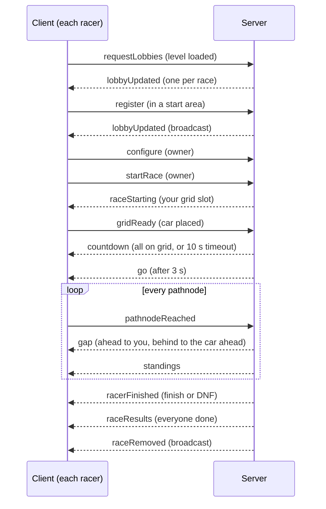

# VRacerMP — Network protocol (v1)

Living document. Event names live in [`shared/protocol.lua`](../shared/protocol.lua);
payloads are built in `Resources/Server/VRacerMP/vracerMP/coordinator/messageBuilder.lua`
(server → client) and `Resources/Client/lua/ge/extensions/vracerMP/controller/clientController.lua`
(client → server). Keep the three in sync.

## Conventions

- Every event name starts with `vracerMP_`.
- Every payload is a JSON object. Client → server uses BeamNG's `jsonEncode`;
  server → client uses the shared `jsonEncoder` (empty lists are `[]`).
- Every race message carries `raceId` (NFR-3). The server ignores messages whose
  `raceId` is not the sender's current race.
- Times are integer milliseconds of race time; 0 = GO.
- Player IDs are BeamMP player IDs. Fake racers (testing) have negative IDs and never
  receive messages.

## Flow

## Client → server

| Event | Payload | Notes |
|-------|---------|-------|
| `vracerMP_requestLobbies` | `{}` | Sent when the level is loaded. Server answers with one `lobbyUpdated` per race. |
| `vracerMP_register` | `{ track: { missionId, level, name, closed, pathnodeCount, defaultLaps }, vehicle: { model, config } }` | Creates the track's race if none is open; first registrant is owner. `pathnodeCount` = crossings per lap. |
| `vracerMP_unregister` | `{ raceId }` | Before the start: leave. After (from the grid on): DNF `retired`; also sent by the race panel's Retire button. |
| `vracerMP_configure` | `{ raceId, laps?, dnfTimeoutSeconds? }` | Owner only, before the start. Laps 1–99 (always 1 on point-to-point tracks); timeout 10–3600 s. |
| `vracerMP_startRace` | `{ raceId }` | Owner only. |
| `vracerMP_gridReady` | `{ raceId }` | Car is on its grid slot. |
| `vracerMP_pathnodeReached` | `{ raceId, crossingNumber, raceTimeMs, lapCompleted }` | `crossingNumber` counts from 1 across laps; the server ignores anything but the next number. `raceTimeMs` comes from BeamNG's race engine (sub-frame precise). |

## Server → client

| Event | To | Payload |
|-------|----|---------|
| `vracerMP_lobbyUpdated` | everyone | `{ raceId, missionId, trackName, closed, state, ownerId, ownerName, laps, dnfTimeoutSeconds, racers: [{ id, name, status }] }`. Also sent when racers finish or retire, so clients know who is free to register again. |
| `vracerMP_raceRemoved` | everyone | `{ raceId, missionId }`. After `raceResults` when a race ends; alone when it was cancelled (everyone left before GO). |
| `vracerMP_raceStarting` | each racer | `{ raceId, missionId, laps, gridSlot, racerCount }` |
| `vracerMP_countdown` | racers | `{ raceId, goInMs }` (3000) |
| `vracerMP_go` | racers | `{ raceId }` |
| `vracerMP_gap` | one racer | `{ raceId, kind: "ahead" \| "behind", gapMs }` — `ahead`: red gap to the car in front (UI-8); `behind`: green gap to the car behind (UI-9). |
| `vracerMP_standings` | racers | `{ raceId, racerCount, entries: [{ id, name, position, lapsCompleted, crossings, status }] }` in race order. |
| `vracerMP_racerFinished` | one racer | `{ raceId, status: "finished" \| "dnf", dnfReason, position, racerCount, totalTimeMs, bestLapTimeMs }` (`-1` = none, `""` = no reason) |
| `vracerMP_raceResults` | racers | The full results object, same shape as the results JSON ([requirements §6](requirements.md#6-results-schema)). |
| `vracerMP_notice` | one player | `{ message }` — why a request was refused (not owner, already registered, ...). |

`state` values: `registering`, `gridding`, `countdown`, `running`, `finished`, `aborted`
(`shared/raceStates.lua`).

## Timing and trust

- GO is decided by the server; each client runs its countdown locally for `goInMs`
  and starts its race clock when `go` arrives (START-5).
- The server compares each reported `raceTimeMs` with its own time since GO. Outside
  −2 s / +1 s it logs a warning (TIME-5). MVP: warning only, the crossing is kept.
- Resets are counted from BeamMP's `onVehicleReset` while racing (TIME-7).

## Results in chat

When a race ends the server sends `Race:serialize()` as compact JSON in one chat message
to everyone (`MP.SendChatMessage(-1, json)`) and prints it to the server console (LOG-1).

## Chat commands (testing)

| Command | Effect |
|---------|--------|
| `/vracer fake [lapSeconds]` | Adds a fake racer (default 90 s per lap) to your race while it is registering. |
| `/vracer` | Lists commands. |
